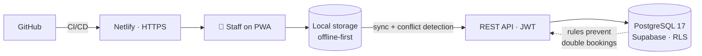

# Hi, I'm Juan David Pareja Salas 👋

📍 Bogotá, Colombia · 🎓 Universidad El Bosque · ☁️ Preparing for AWS Cloud Practitioner

---

## 🧑‍💻 About me

I'm an **8th-semester Systems Engineering student** (graduating **June 2027**) focused on **cloud, DevOps and cybersecurity**. I like owning things end to end: from designing the database and the API, to shipping it to production, to fixing it at 2 a.m. when a Linux box or a network link goes down.

- 🚀 Co-built and shipped an **offline-first PWA that is live in production** for a real two-location business.
- 🛠️ Work daily as a **Tier 2 Technical Support Specialist**, solving **Linux, hardware and network incidents** on live digital signage systems.
- 🔍 Comfortable with **root-cause analysis**, incident management and writing docs so problems don't come back.
- ☁️ Currently studying for the **AWS Certified Cloud Practitioner**.
- 🤖 Use **Generative AI and Claude Code** as part of my daily engineering workflow.
- 🌎 Spanish (native) · English (**C1**).

---

## 🛠️ Tech stack

  

| Area | Stack |
|---|---|
| ☁️ **Cloud & DevOps** | Cloud Computing, Docker, CI/CD, Supabase, Netlify, Git / GitHub |
| 💻 **Programming & Data** | Python, Java, JavaScript, React, REST APIs, SQL, PostgreSQL, Oracle DB |
| 🌐 **Networking & Systems** | Linux, TCP/IP, DNS, DHCP, Routing & Switching |
| 🔐 **Security** | JWT authentication, role-based access control, Row Level Security (RLS) |
| 🧪 **Testing** | Vitest |
| 🤖 **AI** | Generative AI, Claude Code |
| 📋 **Methods** | Scrum, Kanban, Incident Management, Root-Cause Analysis |

---

## 🚀 Featured project

### 📅 Offline-First Web App (PWA) · *Degree project · Feb 2026 – Present*

A production PWA for **appointment, client and revenue management** used by a business with **two locations**. It keeps working when the internet doesn't, and syncs to the cloud when the connection comes back.

- **Cloud back end:** PostgreSQL 17 on **Supabase**, REST API, **JWT auth** and **role-based access control with RLS**.
- **Offline → cloud sync:** local-first data with **conflict detection**, plus database rules that **prevent double bookings**.
- **DevOps:** **Docker** local environment, versioned **SQL migrations** to the cloud, and **continuous deployment to Netlify** over HTTPS.
- **Quality:** tested with **Vitest**.

---

## 💼 Experience

| Role | Company | Period |
|---|---|---|
| **Technical Support Specialist – Tier 2** | Foundever · Client: *Coates Group* | Jun 2026 – Present |
| Customer Service Representative | Concentrix · Client: *Allstate* | Jun 2025 – Jun 2026 |
| Customer Service Representative | TP · Client: *Mercado Libre* | Dec 2021 – Jun 2025 |

**Highlights from Tier 2 support:**
- Diagnose and resolve **Linux, hardware and network incidents** on live digital signage systems.
- Run **root-cause analysis** and document fixes to prevent repeat incidents.
- Guide field technicians through **on-site repairs** following incident management procedures.

> 4+ years in customer-facing roles taught me how to stay calm under pressure, explain technical problems in plain words, and keep the user at the center.

---

## 📜 Certifications

| Certification | Issuer |
|---|---|
| 🗄️ Oracle AI Database Certified Foundations Associate | Oracle |
| 🤖 Claude Code in Action | Anthropic |
| ☁️ Cloud Computing Fundamentals | IBM |
| 🌐 Web Development Fundamentals | IBM |
| 🔌 CCNA: Switching, Routing & Wireless Essentials | Cisco |
| 🐍 Python Essentials 1 | Cisco |
| ⏳ AWS Certified Cloud Practitioner | AWS · *in progress* |

---

## 🎓 Education

- **B.S. Systems Engineering** · Universidad El Bosque · 2024 – 2027 (expected) · *8th semester*
- **Systems Engineering (5 semesters)** · Universidad de San Buenaventura · 2021 – 2023

---

## 🎯 Currently

- 📖 Studying for **AWS Certified Cloud Practitioner**
- 🚀 Maintaining the offline-first PWA in production
- 🛠️ Solving Linux and network incidents on live systems every day

---

## 📫 Let's connect

Looking for an intern or junior role in **Cloud, DevOps or Cybersecurity**? Let's talk!

